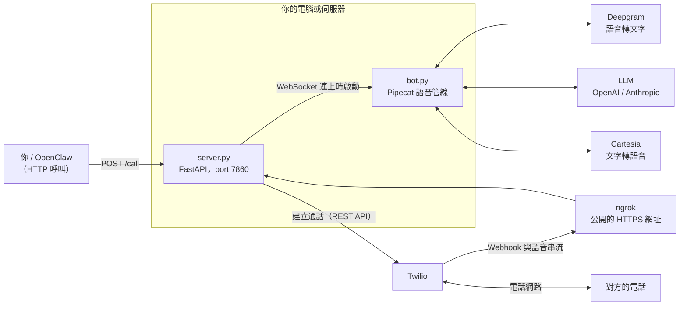
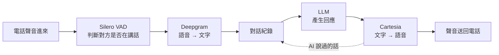
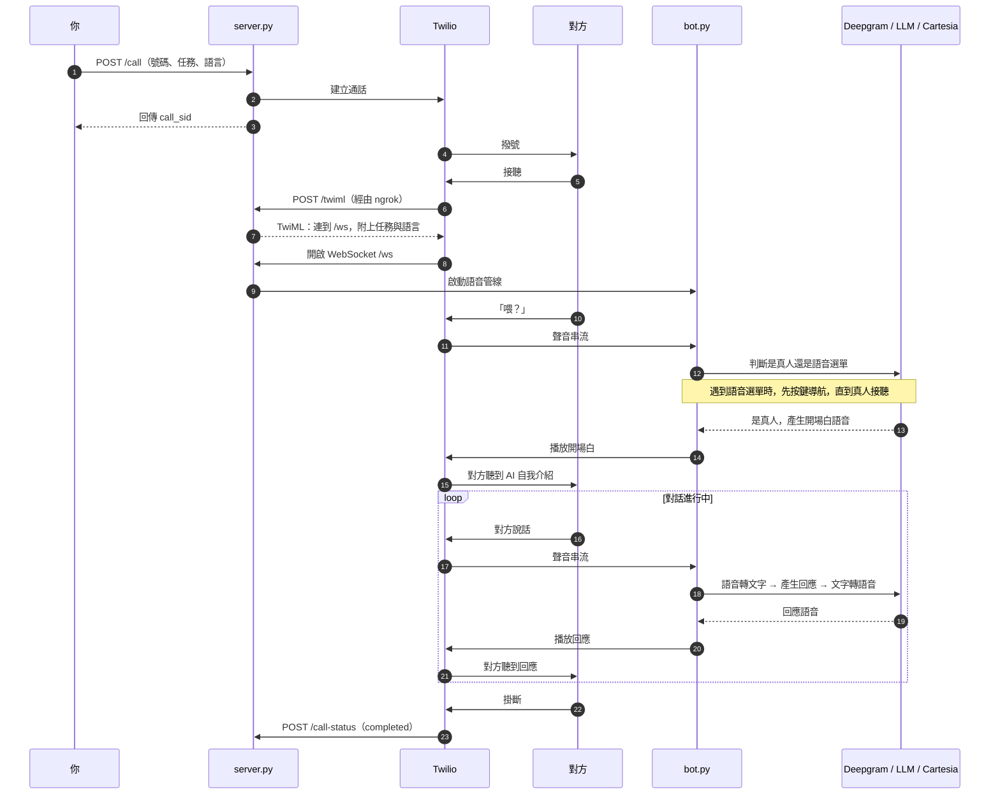
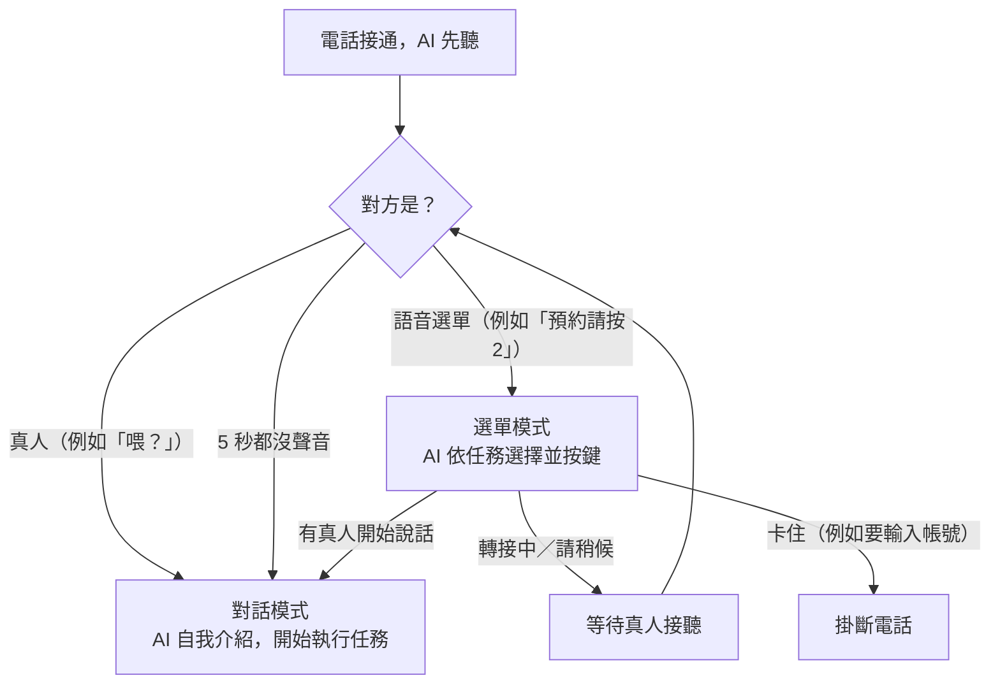

# AI Phone Caller

> 開源的 AI 電話代理人，會幫你打真正的電話。以 [Pipecat](https://pipecat.ai) + [Twilio](https://www.twilio.com) 打造，可自行架設。

告訴它要打給誰、要辦什麼事，AI 就會撥出電話，用自然的口語和對方對話，把事情辦完，例如預約剪髮、詢問訂位、追蹤訂單。

支援語言：**中文（台灣）**、**英文**、**德文**，每通電話可以各自指定。

## 目錄

- [架構](#架構)
- [通話流程](#通話流程)
- [事前準備：申請帳號與 API Key](#事前準備申請帳號與-api-key)
- [安裝與啟動](#安裝與啟動)
- [打一通電話](#打一通電話)
- [語言與聲音](#語言與聲音)
- [分機與語音選單](#分機與語音選單)
- [接聽來電](#接聽來電)
- [設定一覽](#設定一覽)
- [API 說明](#api-說明)
- [費用估算](#費用估算)
- [注意事項](#注意事項)
- [OpenClaw 整合](#openclaw-整合)

## 架構



| 元件 | 角色 |
|---|---|
| **server.py** | FastAPI 伺服器。接收 `/call` 請求、請 Twilio 撥號、回應 Twilio 的 webhook，並在語音串流連上時啟動 bot。 |
| **bot.py** | Pipecat 語音管線，負責「聽 → 想 → 說」的即時對話。 |
| **languages.py** | 各語言的設定：prompt、語音辨識語言、念稿語言、預設聲音。 |
| **Twilio** | 真正撥打電話，並把通話聲音透過 WebSocket 即時串流給 server。 |
| **ngrok** | 讓 Twilio 能從網路連到你電腦上的 server（本機開發時需要）。 |
| **Deepgram / LLM / Cartesia** | 分別負責語音轉文字、產生回應、文字轉語音。 |

### 語音管線（bot.py 內部）



## 通話流程



## 事前準備：申請帳號與 API Key

依下面順序申請，拿到的 key 填進 `server/.env` 對應的欄位（見[安裝與啟動](#安裝與啟動)）。

### 1. Twilio（打電話）

1. 註冊：https://www.twilio.com/try-twilio
2. 登入後在主控台首頁 https://console.twilio.com/ 的「Account Info」找到：
   - Account SID → `TWILIO_ACCOUNT_SID`
   - Auth Token → `TWILIO_AUTH_TOKEN`
3. 買電話號碼：https://console.twilio.com/us1/develop/phone-numbers/manage/search
   - 選有 **Voice** 功能的美國號碼最簡單（台灣號碼需要另外送審文件）
   - 號碼含國碼，例如 `+14155551234` → `TWILIO_PHONE_NUMBER`
4. **開放撥打台灣的權限**：https://console.twilio.com/us1/develop/voice/settings/geo-permissions ，勾選 **Taiwan**（沒開的話打 `+886` 會直接失敗）
5. **試用帳號只能打給驗證過的號碼**，先把自己的手機加進去：https://console.twilio.com/us1/develop/phone-numbers/manage/verified

### 2. Deepgram（語音轉文字）

1. 註冊：https://console.deepgram.com/signup （送 $200 額度）
2. 登入後左側選單 **API Keys** → Create a New API Key → `DEEPGRAM_API_KEY`
   - key 只會顯示一次，請馬上複製

### 3. Cartesia（文字轉語音）

1. 註冊：https://play.cartesia.ai/
2. 取得 key：https://play.cartesia.ai/keys → `CARTESIA_API_KEY`

### 4. OpenAI（LLM）

1. 註冊：https://platform.openai.com/signup
2. **先儲值**（沒有額度 API 無法使用）：https://platform.openai.com/settings/organization/billing ，$5 就夠測試很久
3. 取得 key：https://platform.openai.com/api-keys → `OPENAI_API_KEY`（只會顯示一次）

> 也可以改用 Anthropic Claude：設定 `LLM_PROVIDER=anthropic` 和 `ANTHROPIC_API_KEY`（https://console.anthropic.com/ ），並用 `LLM_MODEL` 指定模型。

### 5. ngrok（讓 Twilio 連到你的電腦）

1. 註冊：https://dashboard.ngrok.com/signup
2. 取得 authtoken：https://dashboard.ngrok.com/get-started/your-authtoken
3. 設定一次即可（不用寫進 `.env`）：
   ```bash
   ngrok config add-authtoken <你的 token>
   ```

## 安裝與啟動

需要 **Python 3.12**（3.14 可能裝不起來）。以下用 [uv](https://docs.astral.sh/uv/) 建立虛擬環境，也可以用一般的 `python3.12 -m venv`。

### 1. 下載與安裝

```bash
git clone https://github.com/petertsengtw/ai-phone-caller.git
cd ai-phone-caller/server
uv venv --python 3.12
uv pip install -r requirements.txt
```

### 2. 設定 `.env`

```bash
cp .env.example .env
```

打開 `server/.env`，填入上一節拿到的 key。也可以在專案根目錄執行互動式設定精靈：

```bash
bash scripts/onboarding.sh
```

`.env` 已被 `.gitignore` 排除，不會被 commit。

### 3. 開啟 ngrok

另開一個 terminal：

```bash
ngrok http 7860
```

把畫面上 `Forwarding` 的 `https://...` 網址填進 `.env` 的 `LOCAL_SERVER_URL`。

> 免費版 ngrok 每次重開網址都會變，記得重新填。

### 4. 啟動 server

```bash
cd server
source .venv/bin/activate
python server.py
```

確認有起來：

```bash
curl http://localhost:7860/health
```

### 用 Docker 執行（選用）

```bash
cd server
docker compose up -d
```

一樣需要先設定 `.env` 並開好 ngrok。

## 打一通電話

```bash
curl -X POST http://localhost:7860/call \
  -H "Content-Type: application/json" \
  -d '{
    "to": "+886912345678",
    "task": "詢問明天晚上七點有沒有兩位的座位，有的話用 Peter 的名字訂位",
    "caller_name": "Peter",
    "language": "zh-TW"
  }'
```

server 的 terminal 會即時顯示通話狀態和對話內容。

## 語言與聲音

| 語言 | `language` 值 | 語音辨識（Deepgram Nova-3） | 預設聲音（Cartesia） | 換聲音的設定 |
|---|---|---|---|---|
| 中文（台灣） | `zh-TW` | `zh-TW` | Feng（男，台灣口音） | `CARTESIA_VOICE_ID_ZH_TW` |
| 英文 | `en` | `en-US` | Skylar（女，美國口音） | `CARTESIA_VOICE_ID_EN` |
| 德文 | `de` | `de` | Nico（男） | `CARTESIA_VOICE_ID_DE` |

- 每通電話用 `/call` 的 `language` 指定；沒帶就用 `.env` 的 `CALLER_LANGUAGE`。
- 想換聲音，到 [Cartesia 聲音庫](https://play.cartesia.ai/voices) 挑一個，把聲音 ID 填進對應的設定。
- 各語言的 prompt（說話風格、禮貌用語等）在 [`server/languages.py`](server/languages.py)，可以直接修改。

## 分機與語音選單

電話接通後遇到總機或語音選單，有兩種處理方式，可以同時使用。

### 方式一：事先指定分機（`extension`）

已經知道要按什麼時，用 `extension` 指定。Twilio 會在電話接通後直接送出按鍵訊號，最穩定。

```bash
curl -X POST http://localhost:7860/call \
  -H "Content-Type: application/json" \
  -d '{"to": "+886223456789", "extension": "wwww123", "task": "詢問報價進度"}'
```

- 可用的字元：`0-9`、`*`、`#`，以及 `w`（等 0.5 秒）
- 在號碼前面加幾個 `w`，可以等總機的語音播一下再按，例如 `wwww123` 是等 2 秒再按 `123`

### 方式二：AI 自動聽選單（`ivr`，預設開啟）

AI 會先聽對方說什麼，判斷是語音選單還是真人：



- AI 會根據 `task` 判斷該按哪個鍵，所以任務要寫清楚，例如「預約剪髮」，AI 才知道要選「預約」
- 選單要求「用說的」回答時，AI 會用該通電話的語言回答
- 這種方式送出的是**按鍵音**（從通話聲音裡播放），大多數總機都能辨識，但少數系統可能收不到。已知分機時建議用方式一
- 開啟時 AI 會**先聽再說**，真人接聽後 AI 要等對方先開口（或等 5 秒）才會說話。如果確定對方是真人、希望 AI 一接通就開口，可以設 `"ivr": false`

兩種方式可以一起用：先用 `extension` 按分機，接下來如果還有選單，AI 再自己處理。

## 接聽來電

AI 也可以接聽打到你 Twilio 號碼的電話：

1. 到 Twilio 主控台的號碼設定：https://console.twilio.com/us1/develop/phone-numbers/manage/incoming
2. 點你的號碼，在「A call comes in」選 **Webhook**，填入 `https://<你的 ngrok 網址>/inbound-twiml`（HTTP POST）
3. 來電時 AI 會以「Botty」的身分接聽，使用 `CALLER_LANGUAGE` 的語言，一接起來就主動打招呼（不啟用語音選單導航）

## 設定一覽

`server/.env` 的欄位：

| 欄位 | 必填 | 說明 |
|---|---|---|
| `TWILIO_ACCOUNT_SID` | ✓ | Twilio 帳號 ID |
| `TWILIO_AUTH_TOKEN` | ✓ | Twilio 密碼 |
| `TWILIO_PHONE_NUMBER` | ✓ | 你的 Twilio 號碼（含國碼） |
| `DEEPGRAM_API_KEY` | ✓ | Deepgram key |
| `TTS_PROVIDER` | | `cartesia`（預設）或 `openai` |
| `CARTESIA_API_KEY` | ✓ | Cartesia key（使用 Cartesia 時） |
| `CARTESIA_VOICE_ID_ZH_TW` / `_EN` / `_DE` | | 自訂各語言的聲音 |
| `OPENAI_TTS_VOICE` | | OpenAI TTS 的聲音（預設 `onyx`） |
| `LLM_PROVIDER` | | `openai`（預設）、`anthropic` 或 `google` |
| `LLM_MODEL` | | 模型名稱（OpenAI 預設 `gpt-4.1`） |
| `OPENAI_API_KEY` | ✓ | OpenAI key（使用 OpenAI 時） |
| `OPENAI_BASE_URL` | | 改用相容 OpenAI 的其他服務時填寫 |
| `ANTHROPIC_API_KEY` | | Anthropic key（使用 Anthropic 時） |
| `LOCAL_SERVER_URL` | ✓ | ngrok 的 `https://` 網址 |
| `PORT` | | server port（預設 `7860`） |
| `CALLER_LANGUAGE` | | 預設語言：`zh-TW`、`en`、`de`（未設定時為 `de`） |

## API 說明

### `POST /call`

撥出一通電話。

```json
{
  "to": "+886912345678",
  "task": "要 AI 完成的事",
  "caller_name": "Peter",
  "language": "zh-TW"
}
```

| 欄位 | 必填 | 說明 |
|---|---|---|
| `to` | ✓ | 對方號碼，含國碼（E.164 格式） |
| `task` | | 這通電話要完成的任務 |
| `caller_name` | | AI 代表誰打電話 |
| `language` | | `zh-TW`、`en` 或 `de`，預設為 `CALLER_LANGUAGE` |
| `extension` | | 接通後要按的鍵，例如 `wwww123`（見[分機與語音選單](#分機與語音選單)） |
| `ivr` | | 是否讓 AI 自動聽語音選單，預設 `true` |

回應：

```json
{
  "call_sid": "CA...",
  "status": "initiated",
  "to": "+886912345678"
}
```

`language` 不支援或 `extension` 含有不合法的字元時，回傳 `400`。

### `GET /health`

健康檢查，回傳 `{"status": "ok"}`。

### 給 Twilio 呼叫的端點

以下由 Twilio 自動呼叫，不需要手動使用：

| 端點 | 用途 |
|---|---|
| `POST /twiml` | 撥出的電話接通時，告訴 Twilio 把聲音串流到 `/ws` |
| `POST /inbound-twiml` | 來電時的 webhook |
| `POST /call-status` | 通話狀態更新（響鈴、接聽、結束） |
| `WS /ws` | 通話聲音的即時串流 |

## 費用估算

每分鐘通話大約會用到下列費用（實際價格以各家官網為準）：

| 項目 | 服務 | 每分鐘約 |
|---|---|---|
| 電話（打美國號碼） | Twilio | ~$0.014 |
| 電話（打台灣手機） | Twilio | 明顯較高，請查 [Twilio 價目表](https://www.twilio.com/en-us/voice/pricing) |
| 語音轉文字 | Deepgram（即時串流） | ~$0.008 |
| 文字轉語音 | Cartesia | 依字數計費，有免費額度 |
| LLM | OpenAI GPT-4.1 | ~$0.01 |

- Deepgram 依**整通電話的長度**計費（包含靜音和 AI 說話的時間）。
- Twilio 依分鐘計費且**無條件進位**（61 秒算 2 分鐘）。
- 測試階段 Deepgram 的 $200 額度可以用很久，主要花費在 Twilio 和 LLM。

## 注意事項

- **Twilio 試用帳號**：只能打給[驗證過的號碼](https://console.twilio.com/us1/develop/phone-numbers/manage/verified)，而且對方接聽後會先聽到一段試用帳號的英文提示，要按任意鍵才會接到 AI。升級成付費帳號就沒有這些限制。
- **打台灣號碼**：要先在 [Geo Permissions](https://console.twilio.com/us1/develop/voice/settings/geo-permissions) 開放 Taiwan。
- **Python 版本**：請用 3.12。`requirements.txt` 已固定 `pipecat-ai==0.0.106`，程式依這個版本的 API 撰寫，升級可能需要改程式。
- **`scripts/start.sh` 在 macOS 無法使用**（使用了 Linux 版 `sed` 的語法），請照上面的步驟手動開 ngrok 和 server。
- **Google Gemini**：目前和 Pipecat 的訊息格式有相容性問題，建議使用 OpenAI 或 Anthropic。
- **回應延遲**：AI 會等對方停頓約 1 秒才回話，避免插嘴；在語音選單模式會等 2 秒，避免選單還沒念完就按鍵。可在 `bot.py` 的 `CONVERSATION_VAD_PARAMS` 和 `IVR_VAD_PARAMS` 調整 `stop_secs`。

## OpenClaw 整合

`skill/` 是給 [OpenClaw](https://openclaw.ai) 用的 skill，讓 OpenClaw 代理人可以直接呼叫這個 server 打電話：

```bash
clawhub install ai-phone-caller
```

安裝後設定環境變數 `AI_PHONE_CALLER_URL` 指向你的 server，就可以對 OpenClaw 說：「打給 +886912345678 的牙醫，問下週最早什麼時候可以約」。

## 隱私與安全

- 預設**不錄音**
- 所有 key 都只存在你自己的機器上
- 除了你設定的服務商之外，不會把資料傳給第三方

## 授權

MIT

## 致謝

- 原始專案：[theopsio/ai-phone-caller](https://github.com/theopsio/ai-phone-caller)
- [Pipecat](https://pipecat.ai)（Daily）：語音 AI 框架
- [OpenClaw](https://openclaw.ai)：AI 代理人平台
